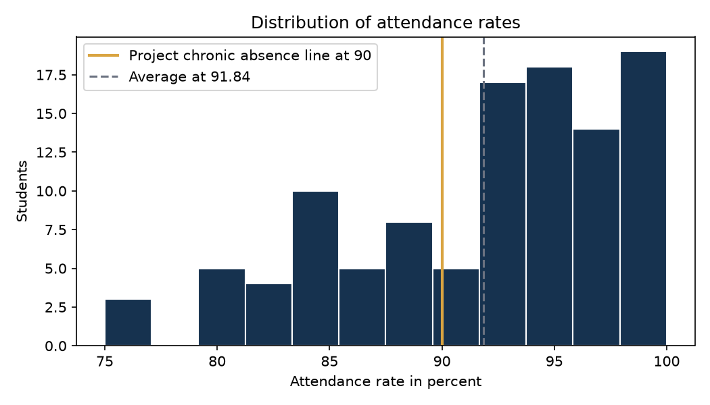
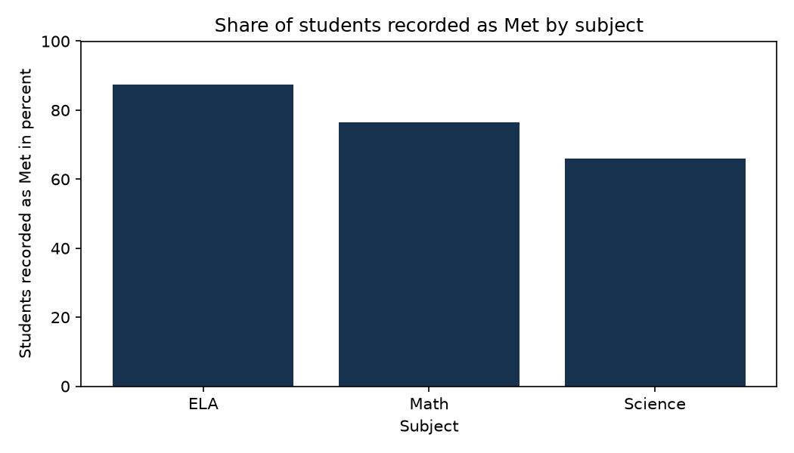
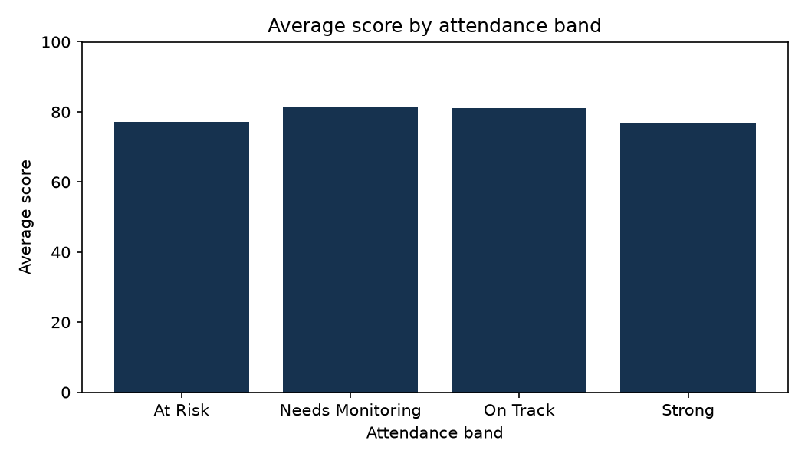

# K-12 Student Data Analytics

A data analytics project that turns four school data extracts into one consistent set of reports. The project covers data profiling, documented cleaning, validation, SQL analysis, Python analysis, an Excel reporting workbook, and a Power BI report with a documented data model and DAX measures.

The dataset is simulated practice data for one school, grades 5 to 8, in the 2025 to 2026 school year. It is not data about any real school or any real student. The value of the project is the workflow and the findings it produces on that data, with every headline number checked across three tools before it is quoted.

## The problem

School leadership teams read attendance and assessment summaries to decide where to put time and support. Those summaries usually come from several source tables at once. When the tables describe different groups of students, the numbers disagree quietly: an attendance average rests on one set of students while a score average rests on another, and nothing on the page says so.

That is exactly what the source data for this project did. The student table held 117 students while the attendance table held 119 rows, including rows for students who do not exist in the student table. This project rebuilds the data around one stated population, documents every change, and keeps the proof that the numbers were checked.

## Business questions

1. What are the headline numbers for the year, and what base does each one rest on?
2. Which grades and programs show the strongest and weakest attendance, and where is absence below 90 percent most common?
3. Where are assessment results strongest and weakest by grade and by subject, and how many students sit below the benchmark?
4. Do students with stronger attendance record higher scores in this data?
5. How are discipline incidents spread across grades, and are they concentrated in a few students or shared across many?
6. How did results move across the January to April 2026 testing window?
7. Can the numbers be trusted? What was changed during cleaning, and do the processed tables pass validation?

The full list, with the questions this data cannot answer, sits in `docs/business_questions.md`.

## The dataset

1. Source: four simulated extracts named students, attendance, assessments, and discipline, preserved unchanged in `data/source`. No earlier raw layer exists for this project, so these extracts are the source of record.
2. Coverage: 117 students in the student table, enrollment dates from September to November 2025, attendance period summaries of 90 to 179 enrolled days, and assessments from January to April 2026.
3. Grain: one row per student in each table. Attendance is a period summary, not daily records. Each student holds at most one assessment, in one subject: ELA, Math, or Science.
4. Analysis population: the 110 students listed as Active. Seven Withdrawn students are excluded because their records cover a part year. The reasoning and the alternative are documented in `docs/methodology_and_limitations.md`.
5. Bases: 108 students hold attendance rows, 107 hold assessment rows, and 109 hold discipline rows. Every average in the project states its base.

## Workflow

Source extracts, then profiling, then cleaning with a written log, then validation checks, then analysis in SQL and Python, then reporting in Excel and Power BI, then reconciliation of the headline numbers across tools.

In file terms: `scripts/01_profile_data.py` profiles the source files. `scripts/02_clean_and_validate.py` builds the processed tables in `data/processed` and writes `outputs/cleaning_log.csv` and `outputs/validation_results.csv`. The files in `sql` answer the business questions in DuckDB. `notebooks/01_exploratory_analysis.ipynb` explores the same tables in Python and produces the charts. `scripts/03_build_workbook.py` builds the Excel report. `scripts/05_build_powerbi_model.py` prepares the Power BI model tables. `scripts/04_reconcile_kpis.py` compares the pandas and DuckDB results.

## Dashboard preview

The Power BI report holds four pages: Executive Summary, Student Performance, Attendance, and Equity and Program. The report is defined in the PBIP text format in `powerbi/powerbi_project`, with the semantic model written in TMDL and the measures documented in `powerbi/dax_measures.md`.

The project files were authored as text on a Linux machine and have not been opened in Power BI Desktop yet. The manual steps to open, refresh, and check the report are written in `powerbi/README.md`, and the numbers behind the report were validated in SQL, Python, and Excel. A browser preview of the report design, built from the same computed values and charts, sits in `powerbi/dashboard_preview.html` for reviewers without Power BI Desktop.

The original dashboard preview image from the first version of the project is preserved at `assets/original_dashboard_preview.png`.

## Headline findings

All figures rest on the analysis population of 110 Active students. Full findings with methods, recommendations, and caveats sit in `docs/insights_and_recommendations.md`.

1. Attendance and scores barely move together in this data. The correlation between attendance rate and score is −0.06 across 105 students, and the Strong attendance band averages 76.60 while the Needs Monitoring band averages 81.27. The dataset does not show the pattern most readers expect, and it cannot prove a cause in either direction.
2. One third of students sit in the chronic absence group. 36 of 108 students with attendance records fall below 90 percent, the project definition, while the median student attends 93.55 percent of days. The average of 91.84 hides this group.
3. MTSS Tier 1 students show the weakest attendance and benchmark results: an average attendance rate of 90.08, a chronic absence rate of 50.0 percent, an average score of 74.93, and 60.7 percent recorded as Met.
4. Grade 6 records the weakest benchmark results, with 63.6 percent of assessed students at Met and an average score of 76.50, against 81.8 percent at Met in grade 7.
5. Subject results differ. ELA records 87.5 percent at Met, Math 76.5 percent, and Science 65.9 percent, with Science holding 14 of the 26 Below results. Each student took one subject, so the rows compare different groups of students.
6. Discipline incidents are widespread but shallow. 78 of 109 students hold at least one incident, the average is 1.32 per student, and only 14 students hold three or more. Grade 8 records the highest rate at 1.60 per student.
7. The shipped files described a different population in every table. Rebuilding them onto one population moved the published average score from 78.1 to 78.48 and the count of students below 85 percent attendance from 22 to 21. Small shifts, reached only because someone checked.

## Recommendations in brief

1. Report attendance as a distribution and a group count beside the average, and review the 21 students below 85 percent as a named list.
2. Open a review of MTSS Tier 1 placements and supports, since the lightest tier holds the weakest snapshot on two measures.
3. Read the grade 6 results by subject before drawing conclusions, and review its eight Below students as a named list.
4. Keep subject comparisons cautious until a future cycle can assess each student in each subject.
5. Keep the population definition, the cleaning log, and the validation checks as standing parts of any recurring version of this reporting.

## Data model and DAX in brief

The model is a small star schema. `dim_student` holds one row per student. `fact_attendance`, `fact_assessment`, and `fact_discipline` hold the measures, each joining to `dim_student` on Student_ID. `dim_date` covers 1 September 2025 to 30 April 2026 and carries the month views. The full description sits in `docs/data_model.md`.

Seventeen DAX measures sit in a dedicated measures table. Base measures count rows and average columns. Group counts use CALCULATE with simple filters. Rates use DIVIDE so a filtered group with no students returns blank rather than an error. Two measures compare a month with the month before it using DATEADD over the date table, with the caveat that each month rests on different students. Every measure is documented with its definition, formula, denominator, and population in `powerbi/dax_measures.md`. KPI definitions shared across all tools sit in `docs/kpi_definitions.md`.

## SQL and Python in brief

The SQL suite in `sql` holds seven DuckDB files. Each opens with the business question it answers and a note on how to read the result. The suite uses joins, CASE logic, common table expressions, UNION ALL groupings, one RANK window function, and one running total. `sql/06_data_validation.sql` counts problem rows in the source files and in the processed tables side by side. `sql/run_all.py` executes the suite and saves results to `outputs/sql_results`.

The Python work uses pandas and matplotlib at a deliberately plain level: reading CSV files, filtering, grouping, merging, counting, and charting. `scripts/01_profile_data.py` and `scripts/02_clean_and_validate.py` form the reproducible pipeline. The notebook `notebooks/01_exploratory_analysis.ipynb` walks through the distributions and group comparisons, and after each result it states in plain words what the result shows and what it does not show.

## Data quality in brief

The audit found fact rows pointing at students outside the population, including 11 rows for students absent from the student table entirely, two category values with casing errors that split their groups, name columns in a file documented as name free, and headline figures in the original README that did not reconcile across tables. The pipeline treats each problem with a documented rule, writes 37 entries to the cleaning log, and runs 15 validation checks on the processed tables. All 15 pass. The full account sits in `docs/data_quality_report.md`.

## How to reproduce

1. Create an environment and install the dependencies: `python3 -m venv venv`, then activate it, then `pip install -r requirements.txt`.
2. Run the pipeline in order: `python scripts/01_profile_data.py`, then `python scripts/02_clean_and_validate.py`.
3. Run the SQL suite from the repository root: `python sql/run_all.py`.
4. Reconcile the headline KPIs: `python scripts/04_reconcile_kpis.py`.
5. Build the Excel workbook: `python scripts/03_build_workbook.py`.
6. Build the Power BI model tables: `python scripts/05_build_powerbi_model.py`.
7. Open `notebooks/01_exploratory_analysis.ipynb` to read or rerun the exploration. Running it rewrites the charts in `assets/charts`.
8. For the Power BI report, follow the manual steps in `powerbi/README.md`.

## File map

1. `data/source` holds the four source extracts as received.
2. `data/processed` holds the cleaned tables: `dim_student`, `fact_attendance`, `fact_assessment`, `fact_discipline`, and the combined `fact_student_summary`.
3. `scripts` holds the pipeline, workbook, model, and reconciliation scripts.
4. `sql` holds the seven DuckDB queries and the runner.
5. `notebooks` holds the exploratory analysis notebook.
6. `powerbi` holds the model tables, the DAX catalog, the PBIP project, the browser preview, and the Power BI notes.
7. `workbook` holds the Excel report built by script. `workbook/original` preserves the two original workbooks from the first version of the project, including the hand built portfolio workbook with its PivotTables.
8. `docs` holds the project documentation. `docs/original` preserves the original data dictionary and data quality log. The original methodology document was merged into `docs/methodology_and_limitations.md`.
9. `assets/charts` holds the charts produced by the notebook. `assets/original_dashboard_preview.png` preserves the original dashboard image.
10. `outputs` holds the generated evidence: the profile summary, the cleaning log, the validation results, the KPI reconciliation, and the SQL result tables.

## Skills demonstrated

1. Data profiling and data quality auditing, with a written cleaning log and before and after counts.
2. Data cleaning in Python with pandas, kept simple enough to explain line by line.
3. Analytical SQL in DuckDB: joins, CASE expressions, common table expressions, grouping, RANK, and a running total.
4. KPI design with stated denominators, and reconciliation of the same KPIs across SQL, Python, and Excel formulas.
5. Excel reporting with live formulas, structured tables, and formatted summary sheets.
6. Power BI semantic modeling in a star schema, with a documented DAX measure library and a report defined in the PBIP text format, with its validation status stated plainly.
7. Data visualization with honest chart choices and caveats written next to the results they qualify.
8. Documentation written for two readers: the analyst who reruns the work, and the hiring manager who reviews it. A rehearsal guide for the second reader sits in `docs/interview_walkthrough.md`.

## Known limitations and future work

1. Attendance is a period summary with no dates, so absence timing cannot be studied.
2. One assessment per student means no growth measurement and no direct subject comparison for the same students.
3. The Power BI project still needs its first open in Power BI Desktop, following the steps in `powerbi/README.md`.
4. With daily attendance records and repeated assessments per student, the natural next steps would be absence pattern analysis inside the year and growth views for the same students over time. Neither is possible with the current extracts, and neither is claimed here.

## Author

Tarini Akula. Portfolio project built to demonstrate data analyst skills on documented, reproducible work.
